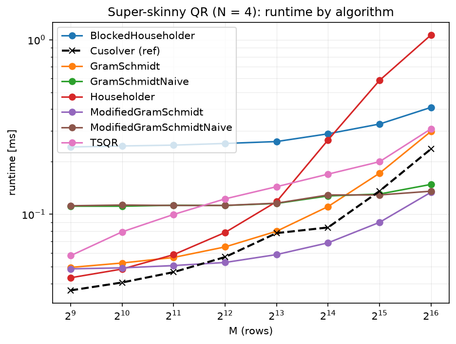
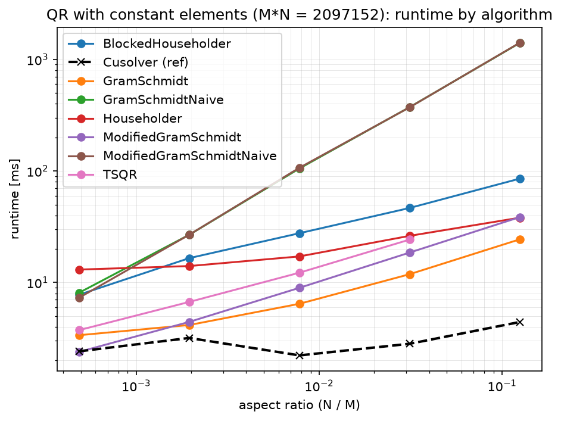

# Matrix Decomposition

QR decomposition on the GPU (CUDA), aimed at **tall and skinny** matrices
(M ≫ N). Common QR routines are tuned for near-square matrices, while use
cases like low-rank approximation need fast QR for N/M ≤ 5%.

Implemented algorithms, each benchmarked against cuSOLVER and CPU versions:

- **Classical / Modified Gram-Schmidt**: naive (dot product + AXPY) and
  improved variants that batch the projections into GEMV + rank-1 updates
- **Householder**: column-by-column reflections
- **Blocked Householder**: panel factorization + GEMM-based trailing update
  (`larft`/`larfb` style)
- **TSQR**: communication-avoiding local QR per block + tree reduction of
  the R factors

All algorithms are tested with GoogleTest for reconstruction error,
orthogonality of Q, upper-triangular R, and a fixed sign convention
(positive diagonal of R).

Final project for the course "HPC Implementierungen B: Beschleuniger".

## Contributors

- [Christof Stein](mailto:christof.stein@student.uibk.ac.at)
- [Max Hirtenlehner](mailto:max.hirtenlehner@student.uibk.ac.at)

## Compiling 

To compile on the cluster:
```bash
mkdir -p build && cd build
cmake -DCMAKE_CUDA_ARCHITECTURES=70 -DCMAKE_BUILD_TYPE=Release ..
make -j8
```
The test then run all Executables with the following job script:
```bash
#!/bin/bash
#SBATCH -p nvltv
#SBATCH -o job-%j.out
#SBATCH -N 1
#SBATCH -t 00:45:00
module load cuda
./build/tests/matdecomp_gpu_tests | tee gpu_tests.log
./build/tests/matdecomp_cpu_tests | tee cpu_tests.log
./build/benchmarks/matdecomp_gpu_benchmarks | tee gpu_benchmarks.log
./build/benchmarks/matdecomp_cpu_benchmarks | tee cpu_benchmarks.log
./build/benchmarks/matdecomp_reference_benchmarks | tee reference_benchmarks.log
```

Available Test Executables:
- `build/tests/matdecomp_gpu_tests`
- `build/tests/matdecomp_cpu_tests`

Available Benchmark Executables
- `build/benchmarks/matdecomp_gpu_benchmarks`
- `build/benchmarks/matdecomp_cpu_benchmarks`
- `build/benchmarks/matdecomp_reference_benchmarks`

## Benchmarks

Benchmarks are bundled in 2 Executables: `build/benchmarks/matdecomp_gpu_benchmarks` and `build/benchmarks/matdecomp_cpu_benchmarks`. And additionally, `build/benchmarks/matdecomp_reference_benchmarks` for reference (CUSOLVER) implementations. These can be run by themselves but benchmark a lot of different sizes which is why a script ([`run_benchmarks.sh`](run_benchmarks.sh)) is provided to run and plot all benchmarks.

This requires a Python environment with the dependencies in `plot/requirements.txt`:

```bash
# From inside plot/ Directory:
python -m venv .venv
./venv/bin/activate
pip install -r plot/requirements.txt
```

Then simply run the script to run all benchmarks and plot the results:

```bash
./run_benchmarks.sh
```

Since this stahses the the benchmarks as JSON emissions from Google Benchmark it is also possible to turn single benchmark runs into plots:

```bash
python plot/plot_benchmarks.py <results>.json
```

The base script produces, in `plot/`: 
- a log-runtime contour over (M, N) per algorithm
- (`contour_<algo>_<dtype>.png`), a square-matrix comparison
- (`square_comparison.png`) for square matrices at N/M = 100%, 50%, 25%, 12.5%, 6.25%
- skinny-matrix comparisons at N/M = 6.25%, 12.5%, 25% (`skinny_comparison_*.png`)
- Extremely skinny-matrix comparisons at N << M (`super_skinny_comparison_N*.png`)
- Same Element count MxN comparisons at different aspect ratios (`constant_elements_comparison_*.png`)

## Results

cuSOLVER wins overall. On very tall and skinny matrices, the improved
Modified Gram-Schmidt matches or beats it. TSQR and Blocked Householder
scale like cuSOLVER but are still slower, because they are not tuned
enough.

| Super-skinny (N = 4) | Constant elements (M·N = 2²¹) |
|---|---|
|  |  |

